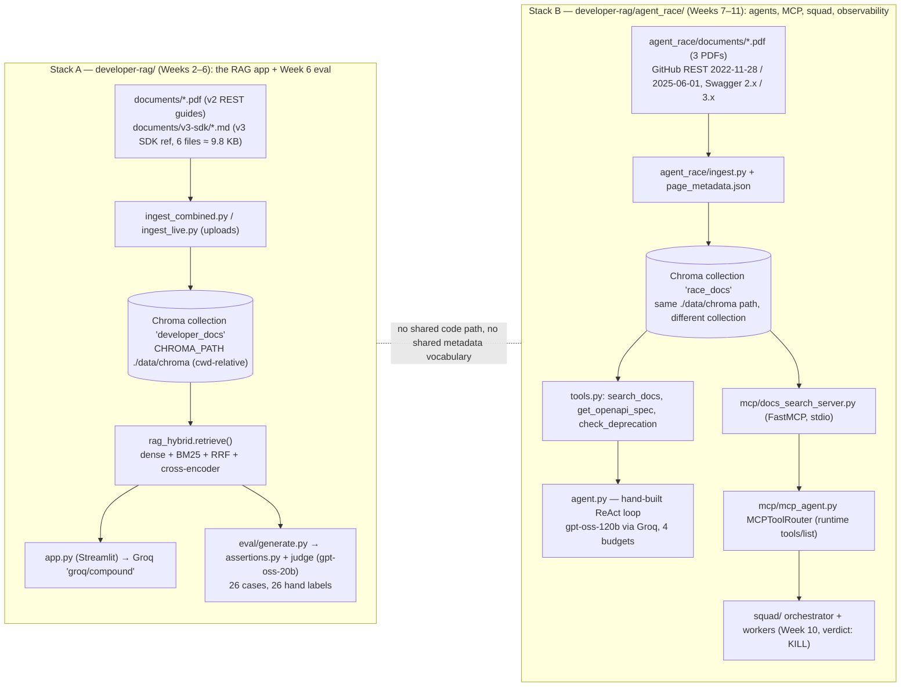

# Week 12 — Current Architecture (Phase 0 discovery)

Date: 2026-11-02 · Branch inspected: `week11_implementation` @ `5e63530` (in sync with `origin/week11_implementation`) · No application code was modified to produce this document.

**Evidence legend** (used in every table below):

| Tag | Meaning |
|---|---|
| READ | I read the source in full in this session. |
| HEADER | I read only the module docstring / header, or a targeted grep. |
| COUNTED | Parsed or counted programmatically in this session (e.g. JSON case counts, AST parse). |
| RAN | Executed in this session. |
| HISTORICAL | Taken from a committed report or result file; **not** re-run here. |
| NOT READ | Exists in `git ls-files` but I did not open it. |

"Verified" in this document means *source was read and, where stated, a check actually ran*. Nothing below was verified against a live LLM, a live vector index, or a live MCP session — none can run on this machine (see `baseline_results.md`).

---

## 1. The repo contains two retrieval stacks that do not talk to each other

**Why this matters for Week 12.** Everything the brief asks to be *integrated* sits on opposite sides of this line:

| Capability | Stack | Corpus it points at |
|---|---|---|
| Hybrid retrieval, structure-aware chunker, uploads, Streamlit UI, Week 6 eval suite + judge + hand labels, symbol registry, Week 5 taxonomy | A | `developer_docs` (v2 REST guides + v3 SDK ref) |
| ReAct agent, trajectory eval (Week 8), MCP client + server (Week 9), squad (Week 10), cost/trace work (Week 11) | B | `race_docs` (GitHub/Swagger API docs) |

The two use different version vocabularies (`v2`/`v3` vs `2022-11-28`/`2025-06-01`/`2.x`/`3.x`) and different metadata schemas (`sdk_version`, `page_type` vs `api_version`, `endpoint`, `content_type`, `has_diff`). Week 11's own `tool_selection.md` hit the same ambiguity ("which Week 6 suite?") and chose Stack B; Week 12 needs both.

---

## 2. Component inventory by layer

### 2.1 Ingestion, chunking, metadata (Stack A)

| Component | File | Evidence | Status |
|---|---|---|---|
| Fixed-window chunker (baseline) | `developer-rag/chunkers.py:38` `chunk_text` — 800 chars / 150 overlap (`config.py`) | READ | Implemented; legacy baseline |
| Structure-aware chunker | `chunkers.py:161` `chunk_structured` — target 1200 **characters**; keeps tables/fenced code whole; header-led chunks; PDF caps-header normalisation | READ | Implemented. Benchmarks exist (`benchmark.py`, `W4_TASK_SET_E_RESULTS.md`) — NOT READ, not re-run |
| Canonical corpus ingest | `ingest_combined.py` → collection `developer_docs`; v2 PDFs get `sdk_version="v2"`, v3 md get `"v3"`, `page_type` per `config.PAGE_TYPE_MAP` | HEADER (grep of metadata assignments) | Implemented; not run |
| Legacy ingests | `ingest.py` (Gemini embeddings via `google-genai`), `ingest_improved.py` | HEADER | Legacy. `config.EMBEDDING_MODEL="gemini-embedding-001"` is only consumed by `ingest.py`; the live query path embeds with local `BAAI/bge-small-en-v1.5` — **a Gemini-embedded index would be dimension-incompatible with the query encoder** |
| Chunk metadata (live) | `source_file, page_id, sdk_version, page_type, section, anchor, source, page, chunk`; id = `{page_id}[:p{page}]:{anchor}:{chunk_index}` | READ (`ingest_live.py`) | No `source_type`, `doc_hash`, `index_version`, `deprecated`, `removed_in`, `replacement`, `code_sample_id`, `scope/owner` |
| User uploads | `ingest_live.py:73` `ingest_uploaded_file` — `.pdf`/`.md` only; writes into the **official** collection with `sdk_version="uploaded"`; dedup is by chunk-id existence (not content hash); no size limit; no owner/session; no delete | READ | **Partial and unsafe for Week 12** (see gap G-UP-*) |
| Stack B ingest | `agent_race/ingest.py` + hand-written `page_metadata.json` (24 pages): `api_version, endpoint, content_type (spec/diff), has_diff` | HEADER | Implemented; not run |

### 2.2 Retrieval (Stack A — `developer-rag/rag_hybrid.py`, READ)

| Stage | Implementation | Notes |
|---|---|---|
| Dense | Chroma cosine (`hnsw:space=cosine`), query encoded by `BAAI/bge-small-en-v1.5` (`normalize_embeddings=True`) | Local, no API cost |
| Sparse | Hand-written `BM25` class (k1=1.5, b=0.75, whitespace tokenisation), **in-memory over the entire collection**, built at import | Rebuilt by `refresh_indexes()` |
| Fusion | `reciprocal_rank_fusion(k=60)` over dense top-25 and BM25 top-60 | |
| Rerank | `cross-encoder/ms-marco-MiniLM-L-6-v2`, lazy-loaded | |
| Metadata filter | `retrieve(where=...)` passes `where` to Chroma **dense query only** (`rag_hybrid.py:245-265`) | **No caller passes it** — `app.py:261` passes `where=None`; `eval/generate.py:71` passes none. The filtered path **skips BM25 and RRF entirely**. |
| Relevance gate | `is_relevant()`: `rerank_score[0] > 0.0`, else `distance <= RELEVANCE_THRESHOLD(0.60)` | Week 5 Mode 2 documents a false-refusal case |
| Known unfixed bug | `rag_hybrid.py:319-320` — `id_to_candidate.update(bm25_candidates)` overwrites real dense distances with placeholder `1.0` (Week 5 Mode 5) | `eval/run_eval.py` still reports the guard as failing; I confirmed the code is unchanged |
| Query rewriting / multi-hop / self-correction | **Not present in Stack A.** | The agent loop in Stack B is the only multi-step mechanism |
| Semantic cache | **Not present.** Only `functools.lru_cache` on query-embedding strings (`app.py:82`), keyed on question text alone | No version/scope in key (harmless today because nothing is cached beyond the embedding) |
| Import side effects | Module import opens Chroma, loads all docs for BM25, loads the embedding model | Makes unit-testing without the full stack impossible without fakes |
| Path fragility | `config.CHROMA_PATH="./data/chroma"` is **cwd-relative**; `agent_race/tools.py` uses an absolute path to the same folder | Running from another directory silently creates an empty store (`get_or_create_collection`) |

### 2.3 Generation and prompts

| Component | Evidence | Notes |
|---|---|---|
| `app.py` `_build_prompt` / `stream_answer` | READ | Groq `groq/compound` (config `GENERATION_MODEL`), temp 0.1, max_tokens 512, streaming. Context cap 1800 chars total / 600 per chunk. Citation instruction: `[chunk_id]`. Retrieved text is interpolated **directly into the prompt with no untrusted-data delimiting or injection handling**. No post-hoc citation check. Citations carry no SDK version. |
| `eval/generate.py` | HEADER | Same retrieve + Groq path for eval |
| Stack B agent | `agent_race/agent.py` READ | `openai/gpt-oss-120b` via Groq (`pricing.MODEL`), `temperature=0.0`, `max_tokens=1024`, `PROMPT_VERSION="agent-v2-mitigated-default"` |

### 2.4 Agents, routing, tools (Stack B)

| Component | Evidence | Notes |
|---|---|---|
| ReAct loop, no framework | `agent.py` READ | Budgets checked every lap: `max_iterations=8`, `max_tokens=8000`, `max_cost_usd=0.01`, `max_wall_clock_s=60`. Tool dispatch is `TOOL_IMPLS[name](**args)` inside try/except. |
| Fixed workflow baseline | `agent_race/workflow.py` HEADER | Deterministic search → spec → deprecation → synthesise |
| Tools | `agent_race/tools.py` READ | `search_docs` (unfiltered semantic), `get_openapi_spec(api_version, endpoint)`, `check_deprecation(api_version, endpoint)`; version/endpoint are enums |
| Squad (supervisor + workers) | `agent_race/squad/*` HEADER + `verdict.md` READ | Week 10 pre-registered verdict: **KILL** — tied accuracy (7/7 vs 7/7), ~1.2× tokens, and a failure test where a dead worker produced a confident wrong answer. Directly relevant to the brief's "don't create agents just to claim multi-agent". |
| Pydantic router / classical routing models | **Not found.** No `.py` file in the repo imports `pydantic`, `sklearn`, `langgraph` or `langchain` (grep, COUNTED); the parent folder `C:\Projects\AI Learning` contains only `Simple_RAG`. | The brief says "inspect the existing Pydantic router". It is not on this machine. See open question Q5. |
| LangGraph | **Not present.** Week 11 docs record that every loop is hand-built by design. | |

### 2.5 MCP (Week 9)

| Component | Evidence | Notes |
|---|---|---|
| Server `agent_race/mcp/docs_search_server.py` | READ | `mcp.server.fastmcp.FastMCP("docs-search")`, **stdio** transport. Tools: `search_docs`, `get_openapi_spec`, `check_deprecation` over `race_docs`. Typed `Literal` args → pydantic validation inside FastMCP. **Does not touch `developer_docs`.** No version filter on search; no symbol checker; no trace ID; no result-size cap beyond `top_k`. |
| Client `agent_race/mcp/mcp_agent.py` `MCPToolRouter` | READ | Reads `mcp_config.json`, spawns each server over stdio, `initialize()`, `list_tools()` at **runtime**, maps tool→server, converts MCP schemas to OpenAI function schemas, raises on name collision. **No per-tool allowlist, no client-side argument validation, no per-call timeout, no output cap, no trace propagation.** Tool descriptions flow into the model prompt unmodified. |
| Other servers/tests | `package_registry_server.py`, `squad/squad_tools_server.py`, `verify_docs_search_server.py`, `wire_capture.py`, `error_transcript_test.py` | NOT READ / HEADER. Exist; **not run**. |
| Independent-client test | `verify_docs_search_server.py` (46 lines) may serve; unverified | See gap G-MCP-4 |

### 2.6 Evaluation (Weeks 5, 6, 8)

| Component | Evidence | Status |
|---|---|---|
| Week 6 suite | `developer-rag/eval/cases.json` — **26 cases** (COUNTED): baseline 15, version_confusion_w6 3, mode1_groq_error 2, mode2_relevance_gate_false_refusal 2, mode3_answerable_wrong_chunks 2, mode4_cross_document 2 | Implemented; **not run** (needs live Groq + index) |
| Hand labels | `eval/labels_25.json` — 26 entries (COUNTED; filename says 25) | Present |
| Judge | `eval/judge.py`, model `openai/gpt-oss-20b`; `judge_v1.txt`, `judge_v2.txt` | Agreement **HISTORICAL**: v1 = 21/26 = **80.8%**, v2 = 20/26 = **76.9%** (`eval/week6_report.md`). **Both below the 85% bar.** |
| Deterministic assertions | `eval/assertions.py` READ | `code_sample_parses` (JS only, via `node --check` if Node exists, else brace heuristic), `endpoints_and_symbols_exist` (flat **v3-only** symbol list in `symbol_registry.json`: 32 SDK symbols, 6 endpoints), `api_version_stated` (keyword heuristic), `distance_not_placeholder` |
| Runner | `eval/run_eval.py` READ | Pass rate by mode, single command |
| Week 5 taxonomy | `developer-rag/taxonomy.md` READ | **5 modes**, 20 of 23 traces sampled (seed 42), dated 2026-08-26 |
| Week 8 trajectory | `agent_race/trajectory_eval.py`, `trajectory_specs.py`, `week8_report.md` | **10 cases** (HISTORICAL): baseline tool_choice_accuracy 1.0, outcome pass rate 0.8; mitigation alone dropped outcome to 0.6; optimized config back to 0.8 |
| Integration-level eval | — | **Does not exist** |

### 2.7 Observability and cost (Weeks 7, 10, 11)

| Component | Evidence | Notes |
|---|---|---|
| `app.py` `write_trace` | READ | `uuid4` trace_id, **raw question and raw answer** appended to `developer-rag/traces.jsonl`, which is **tracked in git**. No redaction. |
| `agent.py` log | READ | Per-call `timestamp`, tokens, `cost_usd`, `result_full`, `prompt_version`. **No `trace_id` in `agent.py`.** |
| `squad/metering.py` `Tracer` | READ | `trace_id` (12-hex), per-call tokens/cost/latency, JSONL sink, provider-retry handling. Only the squad uses it. |
| `week11/extract_trace.py` | HEADER | Builds `trace.json` after the fact from logs; assigns a trace id post hoc |
| PII / secret redaction | **Not implemented anywhere** (grep for `redact|PII|mask|scrub|sanitiz` in `*.py`: no matches). Week 11 `phase1.md`/`phase2.md` explicitly deferred it. | The brief's premise that Week 11 delivered PII redaction does not hold on this branch. |
| Cost | `agent_race/pricing.py` — table has `openai/gpt-oss-120b` and `gpt-oss-20b` only; **no entry for `groq/compound`**, the model `app.py` and `eval/generate.py` actually use, so `cost_usd()` would `KeyError` for it | |
| Trace across MCP boundary | **Not present.** | |
| Incident drill | `week11/drill.md`: documents 00:47 to locate the incident (HISTORICAL, not re-timed) | |

### 2.8 Packaging, config, CI

| Item | State |
|---|---|
| `developer-rag/requirements.txt` | 7 unpinned names: `google-genai, chromadb, streamlit, pypdf, python-dotenv, numpy, sentence-transformers`. **Missing `openai` (imported by `app.py`, `agent.py`, `eval/*`) and `mcp` (imported by Week 9 code).** No lock file. No Python version pin. |
| `.env.example` | None. `config.py:11` raises `ValueError` at import if `GROK_API_KEY` is unset, so **nothing importing `config` runs without a key**. |
| CI | No `.github/`. |
| Tests | No pytest suite. `test_rag.py`, `test_retrieval.py` call the live index; `test_documents.py` reads PDFs. The only offline-runnable test is `agent_race/week11/test_regression_w11.py` (stdlib + fakes). |
| Tracked artifacts | `chroma_db/chroma.sqlite3` is an **empty Chroma shell** (0 collections, 0 embeddings — RAN read-only query). `simple_rag.bundle` (git bundle of `main`, verified OK). `data/` is git-ignored, so **no vector index ships with the repo**. |
| Stashes | Two WIP stashes (`week10_enhancment`, `week10_agent_vs_multiagent_race`). Not touched. |
| GitNexus | `.gitnexus` index was built on `week10_agent_vs_multiagent_race` @ `080e2f1`, now **2 commits behind**; FTS keyword search is degraded on this machine (missing VC++ runtime), and a retrieval query returned nothing. `CLAUDE.md` says it indexes "51 symbols"; the registry reports 1103 nodes — the two disagree. I fell back to direct source reading. |

---

## 3. Feature status classification

**Verified implemented** (source read *and* a check ran here)
- Python syntax validity of all 57 tracked `.py` files (AST parse, RAN).
- `agent.py` loop, default flags and budgets, exercised through the Week 11 regression test with faked I/O (RAN, GREEN — not a live-model result).
- Eval-suite data integrity: 26 cases / 26 labels / symbol registry parse (COUNTED).
- No secret-shaped strings in tracked text files (pattern scan, RAN).

**Implemented, read, but not executed here** (blocked by missing dependencies, `GROK_API_KEY`, and a built index)
- Hybrid retrieval + rerank, structure-aware chunker, live upload ingest, Streamlit app.
- MCP server and runtime-discovery client.
- Week 6 runner, assertions, judge.

**Partially implemented**
- Version-aware retrieval: metadata and a `where` parameter exist; no resolver, no caller, filtered path drops BM25.
- Uploads: functional ingestion, but not scoped, not size-limited, not deletable, mixed into the official corpus.
- Tool layer: three tools exist but are the wrong three for the brief and sit on a different corpus.
- Observability: per-call timestamps/cost in the agent, Tracer in the squad, trace id in the app — three unconnected mechanisms.
- Code validation: JS parse + flat v3 symbol list; not version-aware, no Python.
- Judge validation: exists, below threshold.

**Missing**
- LangGraph orchestration; Pydantic decision schemas / router; SDK version resolver.
- Changelog / migration / deprecation metadata for the SDK corpus; version-scoped docs search; symbol-existence tool.
- Specialist roles that survive the Week 10 evidence.
- Prompt-injection defences; redaction; trace propagation across MCP; citation verification.
- Integrated eval suite (25–40 cases), integration-level hand labels, integration trajectory specs.
- CI, `.env.example`, complete dependency manifest, one documented entry point/CLI.

**Blocked by credentials / infrastructure**
- Any live LLM call (no `.env`, no `GROK_API_KEY`).
- Any retrieval (no `data/chroma`; the tracked `chroma_db/` is empty).
- Any install of the ML stack (nothing installed; only Python 3.14.8, whose wheel support for `chromadb`/`torch` I have not verified).

---

## 4. Week 11 inventory (the branch tip)

`developer-rag/agent_race/week11/`: `week11_plan.md`, `phase0–7.md`, `tool_selection.md`, `drill.md`, `cost_by_stage.md`, `tenx.md`, `deployment_plan.md`, `final_review.md`, `trace.json`, `extract_trace.py`, `fakes.py`, `test_regression_w11.py`, `test_results/red.txt`, `test_results/green.txt`. Source changes to the agent: `agent.py` defaults flipped (`mitigated`, `parallel_hint`, `compact_history` all `True`), `PROMPT_VERSION` added, timestamps + `result_full` added to the log; `deprecation_assertions.py`; `questions.get_regression_cases()`; `trajectory_eval.py` pins its own flags.

Week 11 was run **entirely offline with fakes seeded from historical data** (its own docs say so). Treat Week 11's RED/GREEN as a fake-boundary control-flow test, not a live-model regression.

## 5. Branch selection

`week11_implementation` (`5e63530`) is the tip of a **linear** history: `a88af29 → d797e0e (main) → week4 → week5 → week6 → week7 → week8 → week9 → week10 → week10_enhancment → week11`. Every other local/remote branch is an ancestor of it. `main` (`d797e0e`) is the early "RAG implementation" and is **exactly 12 commits behind, 0 ahead, no merge commits in between** (`git rev-list --count main..HEAD` = 12; `git branch -a --no-merged HEAD` = empty, i.e. every other branch is an ancestor) — it is not the most complete branch. The working tree is on `week11_implementation`, clean except for three untracked files (`.claude/skills/`, `AGENTS.md`, `CLAUDE.md`). **Recommendation: continue on `week11_implementation`; create a `week12_*` branch from it only with your approval.**
