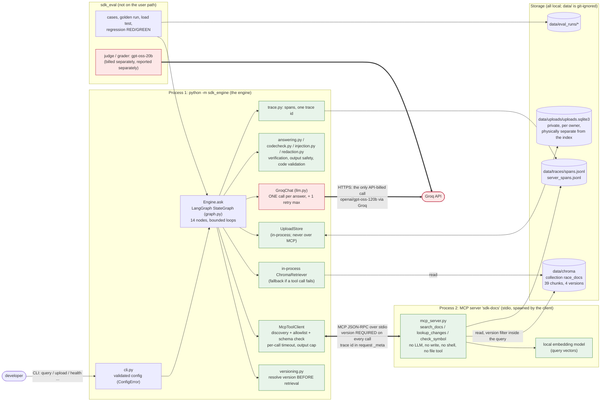
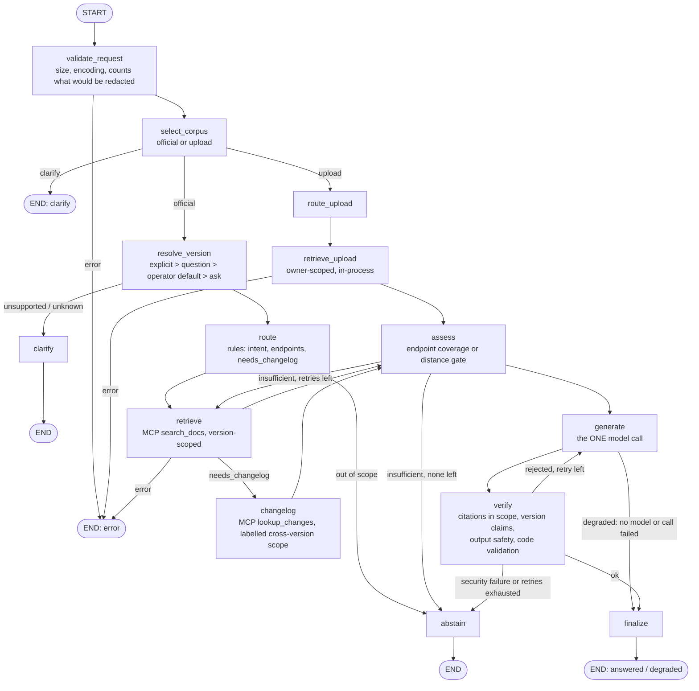
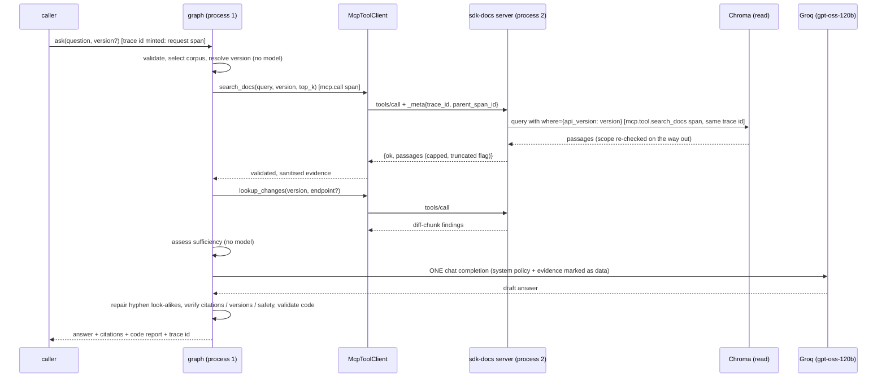

# Week 12 — Architecture (as built), with the target it was designed to

Date: 2026-11-04 · This is the diagram of the **implemented** system, drawn from `sdk_engine/graph.py` (the edges below are the `add_conditional_edges` calls), `mcp_client.py`, `mcp_server.py`, `factory.py` and the span names in the traces. Where the Phase 0 plan (`week12_plan.md` §5) differs from what exists, §4 says so.

## 1. Component boundaries, data flow, model calls, storage, MCP hops, cost boundaries

Cost boundary: only the red nodes touch a paid API. Routing, version resolution, retrieval (local embeddings + Chroma), MCP calls, verification, code checks and tracing are local compute with **no API charge** (they cost CPU time, not dollars; the engine never reports them as 0 USD, it labels them "no API charge (local compute)"). Judge and grader calls exist only in `sdk_eval`, are priced from their own token counts, and are never added to a user query's cost.

Model calls, exactly where they are: **1** in `generate` per answer (a second only when verification rejects the draft and a retry is allowed: 1 of 45 questions in the golden run). **0** in routing, version resolution, tool selection, retrieval, `assess`, `verify`, code validation, `finalize`. Embeddings are a local model (`BAAI/bge-small-en-v1.5`): queries in the MCP server and in the in-process fallback, uploaded text at ingest, the corpus at indexing.

MCP hops per official-corpus question: `retrieve` → `search_docs` (×1, or ×2 for a version comparison), `changelog` → `lookup_changes` (×1 when an endpoint is detected or the question has change intent), `code_validation` → `check_symbol` (per identifier, only when the answer contains a fenced block). Uploaded-document questions make **no** MCP call.

## 2. The state machine (every edge is in `graph.py`)

## 3. One request across the MCP hop (what the trace shows)

If a tool call fails (timeout, error, schema rejection) the graph serves the same request from the in-process retriever, counts it as `mcp_fallbacks`, and the trace says so; the fallback is not a security event.

## 4. Where the build differs from the Phase 0 plan

| Plan (`week12_plan.md` §5) | As built |
|---|---|
| separate `redact_for_logging`, `classify_intent`, `discover_mcp_tools` nodes | redaction is applied at the span sink (`trace.py`, before anything is written) and counted in `validate_request`; intent is decided inside `route`; discovery happens once when the client starts (an allowlist + schema hash, re-validated on every call), not as a graph node |
| `validate_code` node after generate | code validation runs **inside `verify`** (so a SOFT finding can use the same single retry) |
| `finalize_telemetry` | `finalize` plus the request summary on the root span |
| model-proposed routing only if the rules prove inadequate | rules only; no model decides anything but the answer text |
| supervisor / specialist agents | specialist *roles* are labelled nodes and tool calls; no autonomous agents (Week 10's squad did not pay for itself) |
| shared index for uploads | physically separate SQLite store; the MCP server never opens it |

## 5. What the diagram does not show and the system does not have

No authentication (the owner id is caller-supplied), no network service (a CLI and a stdio server), no cache, no queue, no rate limiter of its own, no horizontal scaling story beyond "run more processes against a read-only index" (Phase 10). Known weaknesses, with evidence: `known_weaknesses.md`.
