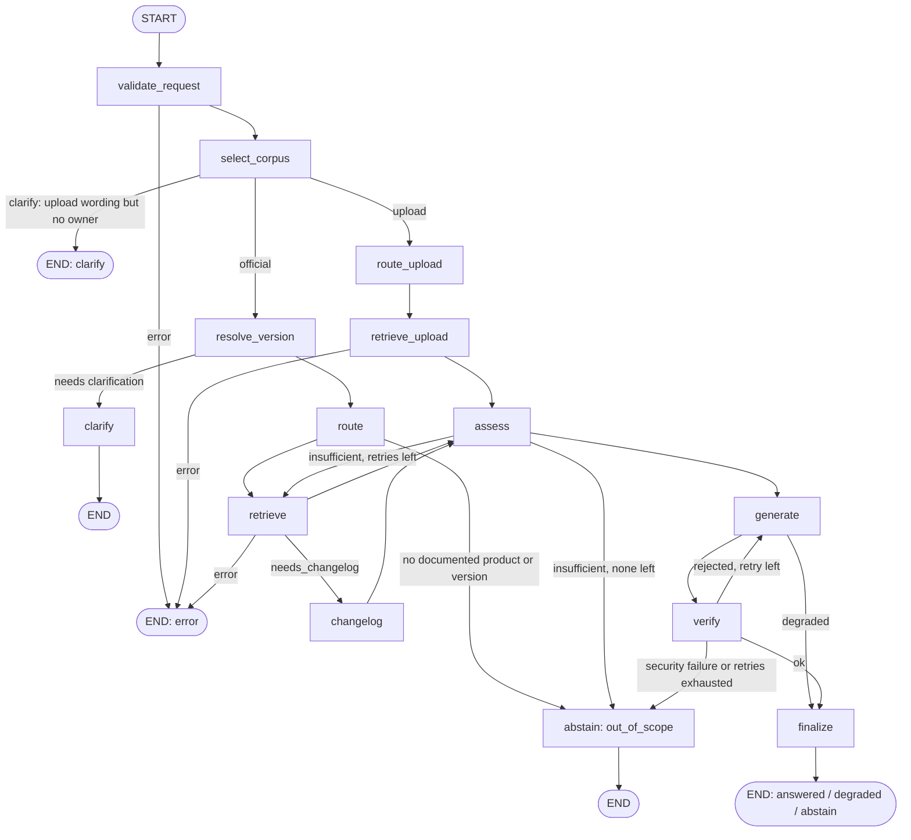
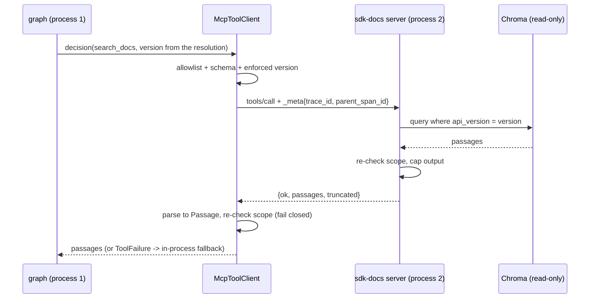

# SDK Docs Answer Engine — technical implementation guide

Describes the code as it exists on branch `week12_implementation` on **2026-11-04**. Nothing is committed: the whole Week 12 build is untracked (`git status` lists `developer-rag/sdk_engine/`, `sdk_eval/`, `tests/`, `docs/`, `.github/`, scripts and requirements files; `git diff --name-status` is empty, so no existing file was modified). It is not a RAG tutorial: every statement below was read from the code in this repository or measured, with the file named. Where I could not verify something, §20 says so.

Status words used in this document: **verified** (read in code *and* covered by a test or a recorded measurement), **partial** (works, with a named gap), **missing** (not built or not measured, with the blocker).

## 1. Status of the brief's requirements

| # | Requirement (brief §18) | Status | Evidence |
|---|---|---|---|
| 1 | correct existing branch and prior work identified | verified | `architecture_current.md` §5: `week12_implementation` cut from `week11_implementation` @ `5e63530` at the owner's choice |
| 2 | original RAG, agent, MCP, eval, logging inspected | verified | `architecture_current.md` (some legacy files header-only, tagged) |
| 3 | one documented entry point | verified | `python -m sdk_engine <command>`; `sdk_engine/README.md`; `tests/test_cli.py` |
| 4 | LangGraph integrated where justified, tested | verified | `graph.py` (14 nodes); `test_graph*.py`, `test_mcp_graph_e2e.py` |
| 5 | version resolved before version-sensitive retrieval | verified | edge order in `graph.py:626-674`; `versioning.py`; 71 tests in `test_versioning.py` |
| 6 | version filtering enforced in the retriever | verified | `retrieval.build_where` + `enforce_scope`; wrong-version chunks 0 of 225 in the live golden run; 51/100 → 0/100 measured in Phase 2; mutation-checked |
| 7 | citations carry the correct SDK version and source | partial | structure verified (`Citation`: source, version, location, chunk id; 35/35 answered golden answers cited). **That a cited chunk *supports* the claim is not checked** (`easy_11`, ledger G-COR-12) |
| 8 | deprecations and removals surfaced proactively | partial | deprecation notes attached to 40 of 45 golden results via the changelog tool; the corpus never states a *removal*, so the engine never claims one; the brief's pagination/removal scenarios are not in this corpus (Q3) |
| 9 | three required tool capabilities | verified | `search_docs`, `lookup_changes`, `check_symbol` (§10), called by the graph, e2e test over a real process boundary |
| 10 | MCP tools discovered at runtime | verified | `McpToolClient.start()` lists tools, hashes schemas, applies the allowlist (`tool_policy.py`); `health --deep` prints the discovered set |
| 11 | our MCP server callable by a separate client | verified | `tests/raw_mcp_client.py` (stdlib JSON-RPC, no `mcp` package) + `test_mcp_protocol_independent.py` |
| 12 | code parsing and version-specific symbol checks where feasible | partial | Python `ast`, JSON, shell/curl, swagger-codegen CLI parsed; identifiers checked per version in evidence tiers; imports, SDK signatures, timeouts and execution are **not checkable with this corpus** and are reported as not checked |
| 13 | uploads indexed, searched, cited, deleted safely | verified within stated limits | physically separate SQLite store; delete verified on disk (0/40 cycles leave text); **no authentication** (G-UP-6) |
| 14 | injection and PII regression tests | verified (residual risk named) | 107 tests in `test_injection`, `test_output_safety`, `test_security_adversarial`, `test_degraded_safety`; `test_redaction`; not "secure": answer wording can be steered (1 of 28 live trials, `phase5.md`) |
| 15 | one trace id survives the agent and MCP hops | verified | `test_mcp_graph_e2e.py`; live trace `evidence/phase7/sample_trace.txt` |
| 16 | integrated suite of 25–40 cases | verified | 40 cases (29 offline / 11 live / 5 regression), 16 brief areas (`sdk_eval/cases.py`) |
| 17 | judge agreement vs hand labels, with denominator | **missing** | **NOT MEASURED**: 0 human labels. Blind 23-item sheet ready (`evidence/phase8/HAND_LABELS_NEEDED.md`); blocker is owner decision Q7 |
| 18 | Week 5 taxonomy 4–7 modes incl. an integration-created one | verified | `error_taxonomy.md`: 7 modes; mode 7 (hyphen look-alikes) integration-created |
| 19 | Week 8 trajectory ≥10 cases | verified, limited | 10 cases; measures the rules, not LLM tool choice (`trajectory_eval.md`) |
| 20 | real or synthetic RED/GREEN loop | verified | `eval regress`: 5/5 real defects RED with the defect re-created, GREEN now |
| 21 | cost per query and stage costs | verified | `cost_by_stage.md`: $0.000388 mean over 45 questions (calculated, not invoiced); only generation is billed; stage times with n and the measurement problems stated |
| 22 | 10× analysis with a bottleneck | verified (workload assumed) | `tenx.md`: first bottleneck is the provider token quota, **hit during evaluation** (200,000 tokens/day ≈ 109 answers on this key); engine ≈ 7 req/s per process second; the workload is an assumption because there is no production traffic |
| 23 | README lets a stranger install, configure, index, query, evaluate | partial | checked against the code by a fresh subagent (18 fixes); unit suite passes in a clean checkout (735); the embedding install, `index rebuild`, `query` and `eval` were **not** completed in a clean checkout (`phase11.md`) |
| 24 | full suite and security checks run | verified | see §19 |
| 25 | known weaknesses and non-coverage explicit | verified | `known_weaknesses.md`, §20 |
| 26 | no secrets, invented measurements or unverified claims | checked, not proven | credential-shaped-string scan of every committable file: 0 hits; every number cites its source file; absence of an unverified claim cannot be proven |

## 2. What is in the repository and where Week 12 sits

Two stacks existed before Week 12 and share no code path: **Stack A** (`developer-rag/*.py`: hybrid RAG over the `developer_docs` corpus, Streamlit app, Week 6 evaluation) and **Stack B** (`developer-rag/agent_race/`: ReAct agent, trajectory evaluation, Week 9/10 MCP code, Week 11 observability) over the `race_docs` corpus. Week 12 adds, **without modifying any tracked file** (`git diff` empty):

| path | lines | role |
|---|---|---|
| `developer-rag/sdk_engine/` | 27 modules, ≈6,360 | the answer engine |
| `developer-rag/sdk_eval/` | 10 modules, ≈1,960 | evaluation: cases, runner, judge, regression, trajectory, golden run, load test |
| `developer-rag/tests/` | 36 files (including helpers) | 754 tests (743 + 11 integration) |
| `developer-rag/scripts/scan_secrets.py` | | credential-shaped-string scan (CI) |
| `developer-rag/.env.example`, `requirements-*.txt` | | configuration template; pinned dependencies |
| `.github/workflows/sdk-engine-ci.yml` | | CI (offline, no secrets) |
| `docs/week12/` | | plan, phases 0–11, evidence, this guide |

Reused unmodified (imported or executed, not edited): `chunkers.py` (structure-aware chunker; GitNexus rated edits HIGH risk), `agent_race/ingest.py` (builds the official index), `agent_race/page_metadata.json` (hand-authored version/endpoint truth), `agent_race/documents/*.pdf` (three reference PDFs), and the Week 6/8 suites (kept runnable as non-regression). Intentionally not added: a frontend, a database server, a cloud service, an observability SaaS, an authentication system.

## 3. Entry point and startup, as the code runs

`python -m sdk_engine query "…" --version 2025-06-01`:

1. `sdk_engine/__main__.py` → `cli.main(argv)`. `_load_dotenv()` loads `developer-rag/.env` without overriding existing variables. The `eval` command is delegated to `sdk_eval.cli`.
2. `build_parser().parse_args` → `_cmd_query`. A `ConfigError` anywhere below is caught in `main`, printed as `error: <message naming the variable>`, exit code 2.
3. `factory.build_engine()`: `EngineConfig.from_env()` (validated, §17) → `VersionCatalog.from_page_metadata` (versions, endpoints, endpoint→product from `page_metadata.json`) → `JsonlSink(trace_dir)` → **`McpToolClient([default_server_config(cfg)]).start()`**: spawns `sys.executable -m sdk_engine.mcp_server` with a minimal explicit environment (and `HF_HUB_OFFLINE=1`), speaks MCP over stdio, calls `tools/list`, validates and registers tools (§10). Startup took 23.7 s in the deep health check (embedding model load in the server process); a failure here prints a warning and the engine continues with the in-process retriever. → `GroqChat(cfg)` only if a key is present (else `llm=None`, degraded answers) → `Deps(...)` with lazy retriever, lazy upload store, lazy symbol index → `Engine(deps)` compiles the LangGraph.
4. `Engine.ask(question, explicit_version, owner_id, scope)` mints a trace id, opens the root `request` span, runs the graph (§8), writes a request summary onto the root span (`summary_version` 1), returns an `AnswerResult` (answer, citations, version resolution, deprecation notes, code validation report, usage and cost, trace id, outcome, reason).
5. The CLI prints the answer, deprecation notes, sources, and one line with outcome, trace id, retrieval path, model calls, cost and latency.

## 4. Models: every one the code can call

| model | role | where | how invoked | billed |
|---|---|---|---|---|
| `openai/gpt-oss-120b` | **the answer**, the only model on the user path | `graph.generate` → `llm.GroqChat.complete` | Groq's OpenAI-compatible endpoint, `temperature=0`, `max_tokens` 1,500, timeout 45 s, **`max_retries=0`** | yes: $0.15 / $0.60 per 1M input / output tokens (`pricing.py`; matches Groq's published page as of 2026-11-04, cached-input discounts not modelled) |
| `openai/gpt-oss-20b` | judge and golden grader | `sdk_eval/judge.py`, `golden.grade` | same endpoint | yes, separately ($0.075 / $0.30); never added to a user query's cost |
| `BAAI/bge-small-en-v1.5` | embeddings: queries, indexing, uploads | `retrieval.make_embed_fn` (single query), `make_embed_many_fn` (batch) via `sentence-transformers`, normalised | local CPU, loaded once per process | no |
| `cross-encoder/ms-marco-MiniLM-L-6-v2` | optional reranker | `retrieval.make_reranker_fn` | **off by default** (`SDK_ENGINE_USE_RERANKER`); measured ~1.1 s p50 on CPU with no top-1 gain (`phase2.md`) | no |
| `hash-test` | deterministic fake embedding | `retrieval._hash_embed` | tests only; lets the suite build and query an index with no model download | no |
| scripted model | the eval suite's worst-case obedient/instant model | `sdk_eval/harness.Scripted` (`scripted/eval-fixture`, unpriced → cost `unavailable`) | offline cases | no |

No classical models and no model-based router exist; the "Pydantic router" the brief mentions was not found on this machine (Q5). The model decides nothing but answer text: version resolution, routing, tool choice, sufficiency, verification and code checks are deterministic code.

## 5. Version resolution (`versioning.py`)

`resolve_version(question, catalog, explicit, config_defaults)` returns a `VersionResolution` (status, product, version, source, candidates, comparison versions, confidence, reason). Order: **explicit caller version** (`--version`) → version(s) named in the question (normalised: `normalize_dashes` first, so U+2011 dates resolve) → operator default **only for a product identified in the question** (`SDK_ENGINE_DEFAULT_VERSION_<PRODUCT>`) → otherwise `needs_clarification`. A version the catalog does not document is `unsupported` and is refused, never substituted. Two versions of one product, or comparison wording, make a labelled **comparison scope**. Product words are ambiguous across products ("markdown" is a GitHub endpoint and a Swagger flag); the resolved product decides (`graph._endpoints`).

## 6. Corpus, chunking, indexing

* **Official index.** `agent_race/ingest.py` (unmodified): extracts the three PDFs with `pypdf`, chunks with the legacy structure-aware `chunkers.chunk_structured`, splits each page into a "spec" part and a "what changed" (diff) part at known markers, attaches **hand-authored** per-page metadata from `page_metadata.json` (`api_version`, `endpoint`, `has_diff`), embeds with bge-small, deletes and re-creates the Chroma collection `race_docs` in `data/chroma`. Result: **39 chunks**, 24 pages, 4 versions (GitHub REST 2022-11-28 ×7, 2025-06-01 ×11; Swagger Codegen 2.x ×8, 3.x ×13).
* **Guard.** `python -m sdk_engine index check` (`indexing.py`) compares every chunk's `api_version` with `page_metadata.json`: 24/24 pages, 0 mismatches, 0 untagged. `index rebuild --yes` runs the legacy ingest and refuses any location other than the one it writes to.
* **Uploads.** `extract.py` (PDF via `pypdf`, DOCX via `python-docx`, Markdown, text) with type/size/page/char/time limits, macro/zip-bomb/traversal/encrypted-PDF rejection, display-only filename; `chunking.py` reuses the legacy chunker **without importing the legacy `config.py`** (which raises with no key): reads the three size constants with `ast`, executes the unmodified `chunkers.py` under a stand-in module, proven equal to the real import by a subprocess test; chunks are embedded locally and stored in `data/uploads/uploads.sqlite3`.
* **Known extraction defect.** PDF text extraction splits long identifiers across lines (`allowUnicodeIdentifie│rs`), which defeats lexical and, in one measured case, semantic retrieval (`error_taxonomy.md` mode 2). Not fixed (needs an index rebuild: owner approval).

## 7. Retrieval (`retrieval.py`)

`ChromaRetriever.search(query, scope, top_k)`:

1. `build_where(scope)` → a metadata filter **inside the vector-store query**: `api_version in scope.versions` (+ optional content type / endpoint); unknown or missing version never matches; for uploads, `owner_id` equality.
2. `collection.get(where=…)` of the whole filtered pool (documents and metadata) — used as the candidate map and for the sparse leg. **This is O(chunks in the version) per query**; negligible at 7–13 chunks, a design limit at scale (measured synthetically in `tenx.md`).
3. Dense query: `embed(query)` (normalised bge vector), `n_results = max(5·k, 25)` capped to the pool, cosine distance.
4. Optional (`SDK_ENGINE_HYBRID`, **off by default**): BM25 over the pool (only if the pool ≤ `MAX_SPARSE_POOL`), reciprocal-rank fusion. Sparse-only hits carry `dense_distance=None`, never a placeholder 1.0.
5. Optional cross-encoder rerank (**off by default**).
6. `enforce_scope(passages, scope)` re-checks every passage on the way out and **fails closed** (`ScopeViolation`).
7. `boost_by_endpoint` (in the graph) moves passages for the endpoint the question names to the front.

The MCP server's `search_docs` runs the same retriever in its own process, with `top_k ≤ 10` and `MAX_PASSAGE_CHARS` 1,500 per passage.

## 8. Orchestration: the LangGraph state machine (`graph.py`)

State (`GraphState`, a `TypedDict`): question, owner, scope hint, corpus, version resolution, route decision, endpoints, passages, deprecation passages, retrieval/generation attempt counters, `draft`, citations, verification flags, `correction`, usage, security events, code report, outcome/answer/reason. Pydantic contracts for the values (`schemas.py`).

| node | does | model call | writes / notable |
|---|---|---|---|
| `validate_request` | strips control characters, length ≤ 2,000, owner-id shape, scope hint; counts what *would* be redacted; scans the question for instruction-like text (telemetry only); mints a per-request **canary** string | no | cleaned question, counters |
| `select_corpus` | `official` or `upload` from the explicit scope or wording (`_UPLOAD_RE`); upload wording with no owner → `clarify` (uploads are never searched without one) | no | `corpus` |
| `resolve_version` | §5 | no | `version` |
| `route` | rules: `needs_changelog = endpoint detected or change wording`; `needs_code_validation` from code words; intent lookup / migration / code_help / out_of_scope; `made_by: "rule"` | no | `route`, `endpoints` |
| `retrieve` | MCP `search_docs` per scope version (×2 for a comparison), falls back to the in-process retriever on a tool failure; doubles `top_k` on a retry; scans passages for injection | no (MCP + local embedding) | passages, `retrieval_via` |
| `changelog` | MCP `lookup_changes`: diff chunks for the caller's version **and newer versions of the same product**, each labelled with the version it applies to (`cross_version`), deprecation facts extracted | no | deprecation passages |
| `assess` | sufficiency: if endpoints were named, an in-scope passage must cover one; otherwise best dense distance ≤ `max_dense_distance` (0.65, a placeholder: **inert on this corpus**, `error_taxonomy.md` mode 4) | no | `sufficient` |
| `generate` | builds the system prompt (`sdk-answer-v1`) and the user prompt (documents wrapped as untrusted data), one completion; **repairs hyphen look-alikes once, here**; degrades if no key/provider failure | **yes (the only one; +1 on a retry)** | `draft`, usage |
| `verify` | citations must name retrieved chunks in scope; claims about versions outside the allowed set are rejected; output-safety checks (canary/prompt leak, configured secret, secret-shaped value not in sources, non-allow-listed hosts and auto-fetch constructs); code validation for official answers with fenced code; one correction retry, then abstain | no | `verified`, `correction` |
| `finalize` | banner `[Product version]`, normalises citations, appends the code-check footer, attaches deprecation notes; abstention text on a model refusal; degraded excerpts (same output checks) when there is no model | no | answer, outcome |
| `clarify`, `abstain` | fixed texts built from the version resolution / reason | no | outcome, reason |

Bounds: `max_retrieval_retries` 1, `max_generation_retries` 1, `max_graph_steps` 25. Outcomes: `answered`, `abstain`, `clarify`, `degraded`, `error`.

## 9. "Agents" and routing decisions

There are no autonomous agents. The specialist roles from the plan are **labelled steps**: documentation researcher = `retrieve`; deprecation/migration = `changelog`; code validation = `verify`'s code check (`codecheck.py`, `symbols.py`); user-document researcher = `retrieve_upload`. Every routing decision is a rule and is recorded with `made_by`. The Week 10 squad measured no gain, so none was added (`tool_selection.md`). If a model-proposed route is ever added, `toolbox.py` already forces it through the same gates (§10).

## 10. MCP integration

**Server** (`mcp_server.py`, FastMCP, stdio, process "sdk-docs"). No LLM, no write/delete/shell/file capability. Every tool **requires `version`**; there is no default and no all-versions mode. Inputs are bounded in the schema itself.

| tool | arguments (all bounded) | returns | notes |
|---|---|---|---|
| `search_docs` | `query` (1–1,000 chars), `version` (required), `top_k` 1–10, optional `content_types` (`spec`/`diff`), optional `endpoints` (`[a-z0-9_]{1,64}`, ≤10) | `{ok, passages[...], truncated, trace_id}` | the retriever of §7; scope re-checked before returning |
| `lookup_changes` | `version` (required), optional `endpoint` | diff items for this version **and newer**, each marked `cross_version`; explicit deprecation statements with the replacement when the docs name one | an upgrade heads-up, never described as the caller's own behaviour |
| `check_symbol` | `version` (required), `symbol` (≤64 chars, `SYMBOL_RE`), optional `endpoint` | `deprecated` / `present_in_docs` / `absent_per_docs` / `not_found` (weak) with evidence chunk ids | never reports "removed": the corpus does not say that |

State (catalog, Chroma handle, retriever, symbol index) is built **before** `mcp.run()` starts reading stdin: importing chromadb on first use inside a tool call, with a stdin read pending, hung the server on Windows (found by a protocol test).

**Client** (`mcp_client.py` + `tool_policy.py` + `toolbox.py`), four gates on every call: (1) a `ToolDecision` built by rules; (2) `validate_decision` against the **discovered, operator-authorised** registry (allowlist by name; schema hash recorded; tool descriptions treated as untrusted and flagged if suspicious) and the tool's JSON Schema, with the caller-owned `version` **enforced** (a decision cannot change it); (3) the call runs under a per-call timeout (20 s) and output cap (20,000 chars), carrying the trace context in the request `_meta`; (4) results are parsed into Pydantic `Passage`s and **the scope is re-checked in the client** — a wrong-version chunk from the other process is a security event (fail closed), not something to paper over by falling back. Anything that is not a security event (unknown tool, timeout, transport error, malformed result, rejected arguments) raises `ToolFailure`; the graph then serves the request from the in-process retriever and records `mcp_fallbacks`.

Evidence returned by the server is sanitised (`_clean`) before it reaches a prompt. Uploaded-document questions make no MCP call.

## 11. Tools inventory (everything that can act)

| tool | kind | process | purpose |
|---|---|---|---|
| `search_docs`, `lookup_changes`, `check_symbol` | MCP | server | §10 |
| in-process retriever, symbol index | local function | engine | fallbacks when a tool call fails |
| `codecheck.validate_code` | local function | engine | parse fenced blocks; check identifiers per version; HARD/SOFT policy; footer |
| `answering.verify_answer`, `output_safety_failures`, `safe_excerpts` | local function | engine | verification and output safety |
| `injection.scan_text` | local function | engine | instruction-like text detector (telemetry; never gates) |
| `redaction.redact_*` | local function | engine | logs and persisted spans |
| `UploadStore` | local object | engine | private uploads |
| `tracequery` (`trace find/show/stats`) | CLI | engine | incident response |

No tool executes user or model code, writes outside `data/`, or shells out (the engine itself starts one subprocess: its own MCP server; `index rebuild` starts the legacy ingest on explicit request).

## 12. Answering, verification and safety (`answering.py`, `codecheck.py`)

* **Prompt** (`PROMPT_VERSION = "sdk-answer-v1"`): policy first (documents are untrusted data; answer only from them; cite ids; abstain with a fixed phrase), the caller's product and version (and comparison versions), a per-request canary; user prompt = the question + each passage wrapped in `<document id=… version=…>` with `<document` neutralised inside the text, capped at `max_prompt_chars` 6,000.
* **Verification** (`verify`): every citation id must be one of the retrieved ids in an allowed version; version labels in the answer text are compared with the allowed set (same-product scoping, dash-normalised); output-safety (prompt leak by canary and 50-character policy windows; the configured key verbatim; secret-shaped values not present in the sources or question — the user's own pasted token echoed in a Bearer header is allowed, an invented one is not; hosts not on the operator allowlist; auto-fetch constructs; `javascript:`/`data:` targets); a security failure withholds immediately with no retry.
* **Code validation**: fenced blocks parsed (Python `ast`, JSON, shell/curl, swagger-codegen CLI); identifiers looked up per version in tiers `cited / elsewhere_in_version / deprecated / absent_per_docs / other_version_only / unverified / not_checked`; HARD findings (a symbol only valid in another version) block, SOFT findings get one correction then a visible warning; the footer lists what was and was not checked.
* **Degraded mode** (no key or provider failure): cited excerpts, passing the same output checks (`safe_excerpts`).
* **Look-alike hyphens**: `ascii_hyphens` applied once at the draft write site (§8).

## 13. Uploads (`uploads.py`, `sqlite_store.py`, `extract.py`)

`upload FILE --owner ID` validates type, size (refused before reading into memory), content, then extracts, chunks, flags instruction-like chunks (kept as data), embeds locally, and writes to the owner's collection in a single SQLite file (`secure_delete=ON`, no WAL, `VACUUM` after deletes). Search is brute-force cosine over the owner's rows (`numpy`); `where` supports only `owner_id`/`doc_id` equality and **raises on anything else**. Content-hash dedup per owner, `list`, `delete`, `purge` (needs `--yes`). A separate store from the official index and never opened by the MCP server. Limits: 5 MB, 200 pages, 1M chars, 500 chunks per document, 25 documents per owner. **Owner ids are caller-supplied: isolation is between scopes, not identities.**

## 14. Observability (`trace.py`, `tracequery.py`)

One `TraceContext` per request; spans carry trace id, span id, parent id, service, name, start/end, status, attributes. The MCP client puts the carrier in the request `_meta`; the server continues it, so `server_spans.jsonl` shares the trace id. Everything persisted passes through `redact_obj` first; question and answer text are **not stored**, only lengths, counts and labels. The root span carries the request summary (version, product, tools, failures, fallbacks, model, tokens, cost + status, attempts, code tiers, reason category). `trace find|show|stats` filters by time, version, endpoint, tool, status, code finding, security, fallback, cost, latency; `show` prints the span tree across the MCP hop and a per-stage table. Cost is `calculated` from real token usage or `unavailable` for an unpriced model, never 0.

## 15. Evaluation (`sdk_eval/`)

`eval list|run|judge|label-sheet|agreement|regress|golden|trajectory|load|history`. 40 cases in `cases.py` (29 offline, 11 live, 5 regression) with deterministic assertions only; the judge (`gpt-oss-20b`, `judge_prompt.txt`) is a secondary signal and never gates a case; `regress.py` re-creates each real defect in-process (RED must fail) then runs the current code (GREEN must pass); `golden.py` runs the 45 golden questions live and grades against the golden answers; `trajectory.py` holds the 10 specs written before the run and the scorer; `loadtest.py` is a bounded local load test with a scripted model. Details and results: `phase8.md`, `phase9.md`, `trajectory_eval.md`, `error_taxonomy.md`.

## 16. Package inventory

Direct, pinned in `requirements-sdk-engine.txt` (Python 3.14.8; `requirements-sdk-engine.lock.txt` is the 137-package snapshot):

| package | version | used for |
|---|---|---|
| `chromadb` | 1.5.9 | official vector index |
| `langgraph` | 1.2.19 | the state machine |
| `mcp` | 1.30.0 | MCP server (FastMCP) and client; **`mcp 2.x` removed `mcp.server.fastmcp`**, so it is pinned below 2 |
| `pydantic` | 2.14.2 | schemas, validated config |
| `openai` | 3.42.1 | OpenAI-compatible client for Groq |
| `pypdf` | 6.21.4 | PDF extraction (ingest and uploads) |
| `python-docx` | 1.2.0 | DOCX uploads |
| `python-dotenv` | 1.2.4 | `.env` loading |
| `numpy` | 2.5.4 | brute-force cosine for uploads |
| `jsonschema` | 4.26.0 | tool-argument validation |
| `pytest` | 9.2.0 | tests (`requirements-dev.txt`) |
| `sentence-transformers` 6.2.0, `torch` 2.15.0, `transformers` 5.22.1 | | local embeddings and optional reranker (`requirements-embeddings.txt`; **not** installed by CI) |

Standard library only for: tracing, redaction, versioning, code checks (`ast`, `shlex`), SQLite store, trace queries, the independent test client.

## 17. Configuration (`config.py`)

`EngineConfig.from_env()` reads environment variables (a blank value counts as unset), converts, and validates; a bad value raises `ConfigError` naming the variable, and the message never echoes a URL (it could carry a credential). `llm_base_url` must be `https` (plain `http` only for localhost/127.0.0.1/::1) with no embedded credentials, because the key is sent there. Collection names are restricted to `[A-Za-z0-9_-]`. Paths are anchored to the package, never the current directory. The key (`GROQ_API_KEY`, else legacy `GROK_API_KEY`) is read lazily by `get_api_key()`, never stored on the config object, never printed. `EngineConfig.public_view()` feeds `health`. Generated from the code:

| field | environment variable | default | bounds |
|---|---|---|---|
| `chroma_path` | `SDK_ENGINE_CHROMA_PATH` | `<developer-rag>/data/chroma` | - |
| `official_collection` | `SDK_ENGINE_COLLECTION` | `race_docs` | - |
| `upload_collection_prefix` | `(no environment variable)` | `uploads_` | - |
| `uploads_path` | `SDK_ENGINE_UPLOADS_PATH` | `<developer-rag>/data/uploads` | - |
| `trace_dir` | `SDK_ENGINE_TRACE_DIR` | `<developer-rag>/data/traces` | - |
| `page_metadata_path` | `SDK_ENGINE_PAGE_METADATA` | `<developer-rag>/agent_race/page_metadata.json` | - |
| `embedding_model` | `SDK_ENGINE_EMBEDDING_MODEL` | `BAAI/bge-small-en-v1.5` | - |
| `reranker_model` | `(no environment variable)` | `cross-encoder/ms-marco-MiniLM-L-6-v2` | - |
| `hybrid_retrieval` | `SDK_ENGINE_HYBRID` | `False` | - |
| `use_reranker` | `SDK_ENGINE_USE_RERANKER` | `False` | - |
| `generation_model` | `SDK_ENGINE_MODEL` | `openai/gpt-oss-120b` | - |
| `llm_base_url` | `SDK_ENGINE_LLM_BASE_URL` | `https://api.groq.com/openai/v1` | - |
| `llm_max_tokens` | `SDK_ENGINE_LLM_MAX_TOKENS` | `1500` | >= 16, <= 4096 |
| `llm_timeout_s` | `SDK_ENGINE_LLM_TIMEOUT_S` | `45.0` | > 0, <= 300 |
| `max_dense_distance` | `SDK_ENGINE_MAX_DISTANCE` | `0.65` | > 0, <= 2.0 |
| `upload_max_dense_distance` | `SDK_ENGINE_UPLOAD_MAX_DISTANCE` | `0.5` | > 0, <= 2.0 |
| `max_prompt_chars` | `(no environment variable)` | `6000` | >= 500, <= 50000 |
| `answer_allowed_hosts` | `SDK_ENGINE_ANSWER_HOSTS` | `8 built-in hosts` | - |
| `default_versions` | `SDK_ENGINE_DEFAULT_VERSION_<PRODUCT>` | `none (operator must set one)` | - |
| `top_k` | `SDK_ENGINE_TOP_K` | `5` | >= 1, <= 20 |
| `max_top_k` | `(no environment variable)` | `20` | >= 1, <= 50 |
| `max_question_chars` | `(no environment variable)` | `2000` | >= 1, <= 20000 |
| `max_graph_steps` | `(no environment variable)` | `25` | >= 1, <= 100 |
| `max_retrieval_retries` | `(no environment variable)` | `1` | >= 0, <= 3 |
| `max_generation_retries` | `(no environment variable)` | `1` | >= 0, <= 3 |
| `tool_timeout_s` | `SDK_ENGINE_TOOL_TIMEOUT_S` | `20.0` | > 0, <= 300 |
| `max_tool_output_chars` | `SDK_ENGINE_MAX_TOOL_OUTPUT_CHARS` | `20000` | >= 100, <= 200000 |
| `max_upload_bytes` | `SDK_ENGINE_MAX_UPLOAD_BYTES` | `5000000` | >= 1000, <= 50000000 |
| `max_pdf_pages` | `(no environment variable)` | `200` | >= 1, <= 2000 |
| `max_extracted_chars` | `(no environment variable)` | `1000000` | >= 1000, <= 20000000 |
| `max_chunks_per_doc` | `(no environment variable)` | `500` | >= 1, <= 5000 |
| `max_docs_per_owner` | `(no environment variable)` | `25` | >= 1, <= 1000 |

Key variables (read lazily, in this order): `GROQ_API_KEY`, then the legacy `GROK_API_KEY`. Defaults are shown with the developer-rag directory abbreviated. Fields marked "(no environment variable)" are fixed in `config.py` (and `hybrid_retrieval` / `use_reranker` are booleans that treat anything but `1/true/yes/on` as off).

## 18. Data and storage

`developer-rag/data/` is git-ignored: `chroma/` (official index), `uploads/uploads.sqlite3` (private), `traces/spans.jsonl` + `server_spans.jsonl`, `eval_runs/`. Committed evidence lives under `docs/week12/evidence/`. The legacy tracked `developer-rag/traces.jsonl` (raw questions and answers from earlier weeks) is untouched pending owner decision Q6.

## 19. Verification evidence (what was run, 2026-11-04)

| what | command | result | denominator / caveat |
|---|---|---|---|
| everything, integration tests included | `python -m pytest -q` | **749 passed**, 247 s (about 02:08, after Phase 9) | includes the 11 tests that need the real index and the local embeddings |
| after the review fixes: unit, protocol, security | `python -m pytest -m "not integration" -q` | **743 passed**, 11 deselected, 208 s (03:09) | |
| after the review fixes: integration (real index, real embeddings) | `python -m pytest -m integration -q` | **11 passed**, 743 deselected, 94 s (21:48 the same evening, after waiting for memory) | together with the row above: all **754** tests pass on the final code |
| clean checkout (no `data/`, no `.env`), fresh venv from `requirements-dev.txt` only (no torch) | same | **735 passed**, 11 deselected, 61 s | before the review fixes; Windows 11, Python 3.14.8 |
| regression RED/GREEN | `python -m sdk_engine eval regress` | **5/5 verified** (RED with the defect re-created, GREEN now); `reg05` RED fails 3 of 3 checks | `evidence/phase9/regress_red_green_after_fix.txt` |
| integrated suite, final run | `eval run --live` (Phase 8) | 40/40 after iteration (first full run 37/39); sensitivity: 9/9 injected engine defects detected, 2 by a single case | `phase8.md`; the suite was tuned until it passed |
| golden set, live, whole engine | `eval golden` | **43/45** judged correct (answerable 34/36, unanswerable refused 9/9); wrong-version chunks 0/225 | `error_taxonomy.md`; judge agreement with a human **not measured** |
| trajectory | `eval trajectory` | path ok 8/10, tool choice 21/23, outcome 10/10, failed calls 0 | rules, not LLM choices |
| local load test | `eval load` (scripted instant model) | 160 requests, 0 failures; 5.4 / 6.9 / 6.8 / 3.1 req/s at concurrency 1 / 2 / 4 / 8 | one machine; `tenx.md` |
| index integrity | `index check` | ok: 39 chunks, 24/24 pages, 0 version mismatches, 0 untagged | real index |
| deep health | `health --deep` | status ok; MCP start-up 23.7 s; three tools authorised; probe search 95.8 ms | real index |
| secret tripwire | `python scripts/scan_secrets.py` | **397 files, 0 suspicious lines** | shape-based: unknown key formats are not found |
| tracked files modified | `git diff --name-status` | **none** | everything is new and untracked |

**Known failures:** `easy_11` (a wrong answer with a citation) and `hard_03` (a false abstention) in the golden run; 26 of 45 requests degraded in the latency run when the provider's daily token quota ran out; the clean-checkout walkthrough of the README was not completed (`phase11.md`).

Details and denominators: `final_review.md` §4, the phase files, and `evidence/`.

## 20. What this document and the system cannot guarantee

* **Correctness of answers.** A wrong answer with a valid-looking citation occurred (`easy_11`); nothing checks that a cited chunk supports a claim. 43/45 on the golden set is the author's set, not held out, judged by a model whose agreement with a human is **not measured**.
* **Refusal on unanswerable questions.** Held 9/9 on nine adjacent questions with one model at temperature 0; the engine's distance gate is inert on this corpus, so the model is the only defence.
* **Security.** Defences are layered and mutation-checked against a worst-case scripted model and three small live runs; they are not a proof. Answer *wording* can be steered by a poisoned passage (1 of 28 live trials). Injection-detector recall is unmeasured. No authentication: the owner id is caller-supplied. A pasted secret is redacted in logs but still reaches the model provider.
* **Corpus coverage.** 39 chunks, two products, four versions. The corpus says "deprecated", never "removed"; pagination and mandatory-timeout scenarios from the brief are not in it and were not invented.
* **Tool selection.** Rules, not model judgement; the trajectory evaluation measures the rules.
* **Performance.** Measured on one Windows machine, one MCP subprocess, a free-tier provider key (8,000 tokens/minute, 1,000 requests/day measured), samples of tens of requests; p99 is not reported. `tenx.md` labels every projection.
* **Portability.** Developed and tested on Windows 11 / Python 3.14.8. The CI workflow has not been run on GitHub; its Linux leg is untested.
* **Cost.** Calculated from token counts and the price table (confirmed against Groq's published page on 2026-11-04); not from an invoice.
* **This document.** It describes the code on the date above. It will drift; the config table is generated from the code, the rest is prose.

## 21. Glossary

* **Version scope** — the set of `api_version` values a retrieval may see: one version, or a labelled comparison of two.
* **Comparison scope** — a scope with two versions, created by explicit comparison wording or by changelog lookups that include newer versions; passages keep the version they belong to.
* **Strict filtering** — the version restriction is a metadata filter inside the vector-store query and is re-checked after retrieval, in both processes.
* **Passage / chunk** — a stored text unit with source, page, anchor, content type (`spec` = reference text, `diff` = "what changed" text), version and endpoint; `chunk_id` is e.g. `swagger_v3_reference:p3:spec:top:3`.
* **Endpoint** — a catalog identifier (`create_issue`, `java_generator`) for the part of an API/CLI a question is about.
* **Outcome** — `answered`, `abstain` (docs do not say), `clarify` (needs a version or scope), `degraded` (no model: cited excerpts), `error`.
* **Fail closed** — on a doubtful scope or an unreadable decision, refuse rather than guess.
* **Canary** — a random per-request string placed in the system prompt; its appearance in an answer means the prompt leaked.
* **MCP** — Model Context Protocol: JSON-RPC between a client (the engine) and a tool server (`sdk-docs`) over stdio.
* **Seam** — a joint between components that each worked alone (`seam_list.md`).
* **RED/GREEN** — a regression case must fail with the defect re-created (RED) and pass on the current code (GREEN).
* **Golden set** — the 45 Week 7 questions with gold answers (36 answerable, 9 not).
* **Placeholder threshold** — a number set without tuning (`max_dense_distance` 0.65), flagged as such in the span that uses it.
