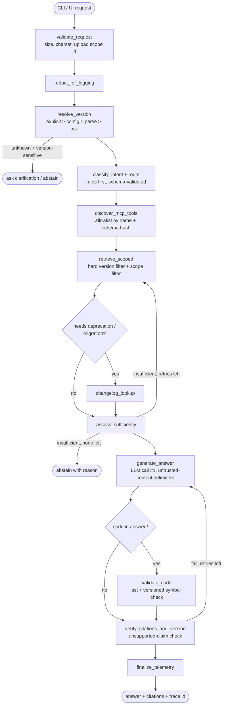

# Week 12 Plan — SDK Documentation Answer Engine (integration + defence)

Date: 2026-11-02 · Author: Claude Code (Sonnet 5.5) with the repo owner · Working branch (proposed): `week12_implementation`, to be created from `week11_implementation` @ `5e63530` **after approval**.

**Status (updated 2026-11-04, after Phase 11): Phases 0–11 are complete or complete-with-named-limits. The engine (`developer-rag/sdk_engine/`), the evaluation suite (`sdk_eval/`), 754 tests (743 unit/protocol/security + 11 integration), all passing on the final code, pinned requirements, `.env.example`, a CI workflow and `docs/week12/` exist and are all untracked: no existing file was modified (`git diff` is empty). Nothing has been committed, pushed or deployed. Not done and not claimed: judge-vs-human agreement (needs the owner's labels, Q7), the CI run on GitHub, and two fixes left for the owner's approval (re-chunk the index; add a claim-support check). Start with `final_review.md`, `known_weaknesses.md` and `technical_implementation_guide.md`.** This replaces the 2026-11-02 status line (Phases 1–2 implemented; 3–11 not started); the per-phase history is in `phase0.md`–`phase11.md`.

Docs location: the brief names `docs/week12/` (repo root). The repo's earlier weeks put docs beside code (`developer-rag/agent_race/week11/`); I followed the brief literally. Moving the folder is trivial if you prefer the old convention. The final guide's path will be `docs/week12/technical_implementation_guide.md`.

## 1. Branch decision
`week11_implementation` is the most complete branch: linear history, every other branch is an ancestor, 12 commits ahead of `main`, 0 behind, in sync with its remote. `main` is the early RAG only. See `architecture_current.md` §5.

## 2. Original architecture (summary — details in `architecture_current.md`)
Two stacks in one repo with no shared code path: **Stack A** (`developer-rag/`: hybrid RAG over `developer_docs`, uploads, Streamlit, Week 6 eval/judge/labels) and **Stack B** (`developer-rag/agent_race/`: ReAct agent, trajectory eval, MCP client/server, killed squad, Week 11 observability) over a different corpus (`race_docs`). Week 12's job is to join them behind one entry point.

## 3. Gaps
57 gaps catalogued in `gap_analysis.md` (58 table rows; G-SEC-5 is a positive finding, not a gap). Four were added after the environment was built and measured (G-COR-9, G-MCP-7/8/9). The S1 ones that drive the plan: no usable environment/index/key; SDK corpus too thin for the required scenarios; version filter exists but is never applied; uploads mixed into the official corpus; no orchestrator/schemas; MCP serves the wrong corpus and has no allowlist/timeouts/trace propagation; no injection defence or redaction; judge agreement below 85%; no integrated eval.

## 4. Selected tools
See `tool_selection.md`. Headline: reuse Chroma, bge embeddings, BM25+RRF, cross-encoder, Groq, `mcp`, `pricing.py`, Tracer pattern. Propose only `langgraph`, `pydantic`, `pytest`, `python-docx` as new. Everything safety-critical (version filter, redaction, symbol checks, tracing, independent MCP client) is stdlib and deterministic.

## 5. Target design (preview; full version goes in `architecture_target.md` after approval)

Cost principle: **exactly one mandatory LLM call per answer** (generation). Routing/decisions are deterministic rules first; a model-based decision is a *proposal* validated by Pydantic and an allowlist, used only when the rules are low-confidence and only if the eval shows the rules are inadequate.

Specialist roles are **LangGraph nodes returning structured findings**, not autonomous agents, until measurement says otherwise (Week 10's squad did not pay for itself): Documentation Researcher = `retrieve_scoped`; Deprecation/Migration = `changelog_lookup`; Code Validation = `validate_code`; User-Document Researcher = `retrieve_scoped` with an upload scope. A supervisor LLM is added only if trajectory evaluation shows a measurable gain.

Three required tools: version-scoped docs search (MCP server), changelog/deprecation lookup (MCP server), version-specific symbol check (local deterministic tool, optionally also exposed over MCP).

## 6. Phases, order, and status

Order is adjusted from the brief's §17 because the environment blocks live runs: build and test the deterministic core first (works with no index/key), then wire live components once the environment exists.

| Phase | Scope | Depends on | Status |
|---|---|---|---|
| 0 | Discovery, baseline, plan | — | **DONE** (this folder; awaiting your decisions) |
| 1 | Contracts: Pydantic state/decision schemas, trace context, redaction, config, bounded LangGraph pipeline, pluggable LLM, one CLI entry point | Q1, Q4 | **DONE for its scope** — see `phase1.md` (171 tests green; CLI exercised on the real index in degraded mode; first live generation run 2026-11-03 — see addendum) |
| 2 | Version resolver, scoped retriever, hard filter on dense + BM25, metadata schema, fail-closed unknowns | Q3 | **PARTIAL** — resolver + hard filter done, measured (wrong-version chunks 51/100 → 0/100) and wired in; chunk-metadata enrichment (doc hash, index version, deprecation fields) not done — see `phase2.md` |
| 3 | MCP server (SDK docs search, changelog, symbol check), runtime-discovery client with allowlist/timeouts/caps, independent stdlib client test | Phase 2 | **DONE for its scope** — see `phase3.md` (272 tests green; one trace id proven across graph → client → server; `check_symbol` not yet called by the graph — Phase 6) |
| 4 | Uploads: validation, hashing, scoped collection, list/delete, isolation tests | Phase 2 | **DONE for its scope** — see `phase4.md` (391 tests green; physical deletion measured and verified at 0/40; **no authentication; no live-LLM answer quality yet**) |
| 5 | Prompt-injection defences, redaction, security regression tests | Phase 1 | **PARTIAL** — layers built and mutation-checked, 3 small live runs, 509 tests passing; residual risk (answer-wording steering, unmeasured detector recall) documented in `phase5.md`; not "secure" |
| 6 | Code validation (`ast`, versioned symbols), citation verification, deprecation surfacing | Phase 2, Q3 | **PARTIAL** — see `phase6.md`: fenced blocks parsed and identifiers checked per version via `check_symbol` (MCP, in-process fallback); wrong-version samples are not delivered; 578 tests passing; imports/signatures/timeouts/execution **impossible with this corpus and reported as not checked**; live model never triggered the blocking path in 19 question-runs (11 distinct) |
| 7 | Unified tracing across entry→graph→retriever→MCP, trace query CLI, one end-to-end redacted trace | Phases 1, 3 | **COMPLETE for its scope** — see `phase7.md`, `incident_drill.md`: one trace id across the real process boundary; request summary + `trace find/show/stats`; live end-to-end trace and a scan of every persisted file; drill run twice, blind, on a **synthetic** log (did not single out one request); 615 tests passing. Open: no log rotation, pasted secrets still reach the model provider (owner decision) |
| 8 | Integrated eval suite 25–40 cases (reuse Week 6), judge re-check on **your** hand labels, RED/GREEN regression | Env + key for live tier | **COMPLETE except the judge check** — see `phase8.md`: 40 cases (29 offline / 11 live / 5 regression), all 16 areas, deterministic assertions, final run 40/40 (first full run 37/39), 5 real-failure regressions verified RED→GREEN, suite sensitivity 9/9; a real engine defect (non-ASCII hyphens) found and fixed. **Judge agreement vs human labels NOT MEASURED: needs your labels** (`evidence/phase8/HAND_LABELS_NEEDED.md`, 23 blind items); 679 tests passing |
| 9 | Week 5 taxonomy re-score (4–7 modes, ≥1 integration-created), Week 8 trajectory ≥10 cases | Phase 8 | **COMPLETE** — see `phase9.md`, `error_taxonomy.md` (7 modes, 1 integration-created), `trajectory_eval.md` (10 cases, measures the rules not LLM tool choice): 43/45 golden questions judged correct; a real defect found and fixed (hyphen look-alikes in 17/35 answers); a wrong cited answer (`easy_11`) and a retrieval miss left for owner approval |
| 10 | Cost per question by stage, latency p50/p95, 10× analysis, bounded local load test | Phases 7–9 | **COMPLETE with a broken measurement stated** — see `phase10.md`, `cost_by_stage.md`, `tenx.md`: $0.000388/question; the provider's daily token quota (200,000) ran out during the latency run (26/45 degraded cleanly), so with-model latency is n = 19 single-version only; load test ≈7 req/s/process; first bottleneck = provider quota |
| 11 | Packaging: one CLI entry point, README, `.env.example`, pinned deps, CI (offline, no secrets), health check | all | **COMPLETE with named limits** — see `phase11.md`: validated config, `index`, `mcp-serve`, `health --deep`, README reviewed by a fresh subagent against the code (18 mismatches fixed, 3 real defects fixed), clean-checkout walkthrough, CI workflow written but **never run on GitHub** |
| Docs | `technical_implementation_guide.md`, `final_review.md`, `demo_script.md`, `known_weaknesses.md`, `fresh_eyes_review.md`, seam list, `architecture_target.md` | all | **DONE** — all files named in the brief §16 exist under `docs/week12/` (the technical guide is at `docs/week12/technical_implementation_guide.md`, the path the brief names) |

Live-dependent items (full Week 6 run, judge agreement, trajectory eval, real cost/latency, real MCP round trip) **cannot be completed** until Q2 and Q8 are resolved; if they stay unresolved I will mark those items incomplete with the blocker rather than simulate them.

## 7. Risks

| Risk | Mitigation |
|---|---|
| No environment/index/key ⇒ temptation to fake results | Deterministic tier first; every fake labelled; live tier explicitly gated; no invented numbers |
| SDK corpus too thin ⇒ scenarios cannot be demonstrated honestly | Decision Q3; any authored content is labelled `synthetic-fixture` in metadata and docs and excluded from "official" claims |
| LangGraph / Python 3.14 compatibility | Nodes are plain functions; graph is thin wiring; verify in the venv before committing to it |
| Judge agreement stays < 85% | Report the real number and denominator; improve the judge prompt only on a held-out split; never relabel |
| Groq free-tier rate limits (Week 11's measured first bottleneck) | Deterministic assertions first; cache judge calls by hash; bounded concurrency; report rate-limit waits separately |
| Existing behaviour regressions | Keep Week 6 suite and Week 11 regression test green; small reviewable changes; `detect_changes` before any commit |
| GitNexus index stale | Re-index before edits; `impact` before touching each symbol (per `CLAUDE.md`) |
| Windows sandboxing weak | Static validation only; no execution of untrusted code |

## 8. Acceptance criteria (brief §18) — current state

| Criterion | State |
|---|---|
| Correct branch and prior work identified | **Done**, pending your confirmation (Q1) |
| Original RAG/agent/MCP/eval/logging inspected | **Done** (some files header-only; see evidence tags) |
| One documented entry point; LangGraph; version resolution/filtering; citations; deprecations; three tools; MCP discovery; independent client; code checks; uploads; injection/PII tests; single trace id; 25–40 case suite; judge ≥85% measured; 4–7 taxonomy modes; ≥10 trajectory cases; RED/GREEN loop; cost; 10×; README; full suite run; known weaknesses | **Done except judge ≥85% (NOT MEASURED, needs the owner's labels)**; per-item status and evidence in `final_review.md` |
| No secrets / invented measurements | Holding: secret scan clean; every number in `baseline_results.md` is RAN or labelled HISTORICAL |

## 9. Decisions needed from you
1. **Q1 Branch** — create `week12_implementation` from `week11_implementation`, or work directly on `week11_implementation`?
2. **Q2 Environment** — create a git-ignored `.venv`; which Python? (3.14.8 is the only one installed; ML-wheel support is unverified.)
3. **Q3 Corpus** — the SDK docs can't support v2.4-pagination / removed-method / mandatory-timeout scenarios. Options: (A) keep `developer_docs` and add a small, clearly-labelled synthetic v2.x/v3 changelog + migration + code-sample set; (B) use `race_docs` (real GitHub/Swagger versions with real deprecation diffs) as the version corpus; (C) unify both under one scoped schema.
4. **Q4 Dependencies** — approve `langgraph`, `pydantic`, `pytest`, `python-docx`, and declaring/pinning `openai`, `mcp`?
5. **Q5** — the brief mentions an existing Pydantic router and classical routing models; I could not find them. Do they exist elsewhere (e.g. your Mac)?
6. **Q6** — `developer-rag/traces.jsonl` (raw questions/answers) is tracked in git; leave it, or untrack/scrub later (I will not do either without your say)?
7. **Q7** — judge agreement needs **your** hand labels on integrated outputs; are you able to label ~25–30?
8. **Q8** — will you provide a Groq key for live runs, and is the free tier acceptable?
9. **Q9** — OK to re-index GitNexus (`node .gitnexus/run.cjs analyze --index-only`; writes only `.gitnexus/`) before the first edit?

## 9a. Decisions received (2026-11-02) and their consequences

| # | Decision | Consequence for the plan |
|---|---|---|
| Q1 | New branch `week12_implementation` from `week11_implementation` | Done. Untracked files carried over; nothing else changed. |
| Q2 | Try a `.venv` on Python 3.14 first | `.venv/` created (git-ignored). Stage 1 (pydantic, mcp, openai, pytest, python-docx, langgraph, pypdf, python-dotenv, numpy) installed cleanly on 3.14. Stage 2 (chromadb, sentence-transformers/PyTorch) was still installing when this was written — outcome recorded in `phase1.md`. |
| Q3 | **Corpus B: `race_docs`** (real GitHub REST 2022-11-28 / 2025-06-01 and Swagger Codegen 2.x / 3.x) | The version corpus is `race_docs`. "SDK version" = `api_version` (date-style for GitHub, `2.x`/`3.x` for Swagger). Brief examples are adapted to what the corpus really contains (e.g. `assignee`→`assignees` in 2025-06-01, `make_latest`, `maintainer_can_modify`, issue `type`, Swagger 2.x→3.x generator/config changes); **pagination is not in the corpus and will not be invented**. The corpus says "deprecated", never "removed"; the symbol checker will never claim a removal without evidence. Stack A (`developer_docs`, 26-case Week 6 suite, judge, labels) is **kept intact and runnable as the non-regression legacy suite**, not deleted or shrunk. Uploads move to a scoped collection and are queried alongside, never merged into, `race_docs`. The integrated suite and its hand labels target `race_docs` and reuse the 10 race questions + 45-question golden set. |
| Q4 | Approved: `langgraph`, `pydantic` v2, `pytest`, `python-docx` | Installed in the venv. Declaring/pinning `openai` and `mcp` is part of the manifest fix. |

**New finding that needs a call from me (within the approved scope):** `pip` resolved `mcp 2.3.0`, which **removed `mcp.server.fastmcp`** (renamed `MCPServer`). The three existing Week 9/10 servers import `FastMCP`. I will pin **`mcp<2`** (preserve working components; migrating to 2.x buys nothing here) and reinstall in the venv. If you would rather migrate to 2.x, say so.

**Still open, non-blocking, with the defaults I will use unless told otherwise:**
- Q5 (Pydantic router location): assume it does not exist; build schemas fresh.
- Q6 (`traces.jsonl` tracked): leave untouched; new traces go to a git-ignored path.
- Q7 (hand labels): I will not label for you; the judge-agreement item stays **incomplete** until you provide labels.
- Q8 (Groq key): **resolved 2026-11-03** — key present in the git-ignored `developer-rag/.env` as `GROQ_API_KEY`; the free tier's rate limits remain the likely bottleneck for the full evaluation (Week 11's measured finding).
- Q9 (GitNexus re-index): run, since `CLAUDE.md` prescribes it and it writes only `.gitnexus/`.

## 10. Phase 0 files created (all new, docs only)
`docs/week12/week12_plan.md`, `architecture_current.md`, `gap_analysis.md`, `tool_selection.md`, `baseline_results.md`. Application code, tests, data and config: **unchanged**. Working-tree status after this phase: the three pre-existing untracked items plus `docs/`.

## 11. Notes on the brief
- The second pasted section ("Additional task — implementation-verified technical documentation") is queued for the end of Week 12; it appears truncated at "### 15. Final review … 1. Verify". I'll treat the missing tail as "verify claims against code/tests, then report", unless you send the rest.
- Premises that do not hold on this branch (so the plan does not assume them): an existing Pydantic router; Week 11 PII redaction; an existing integrated suite; a built index; installed dependencies.
